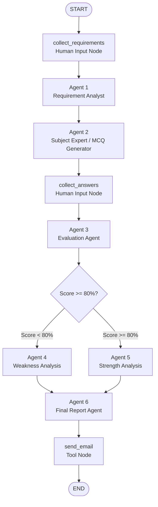
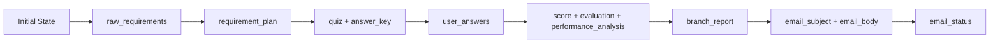
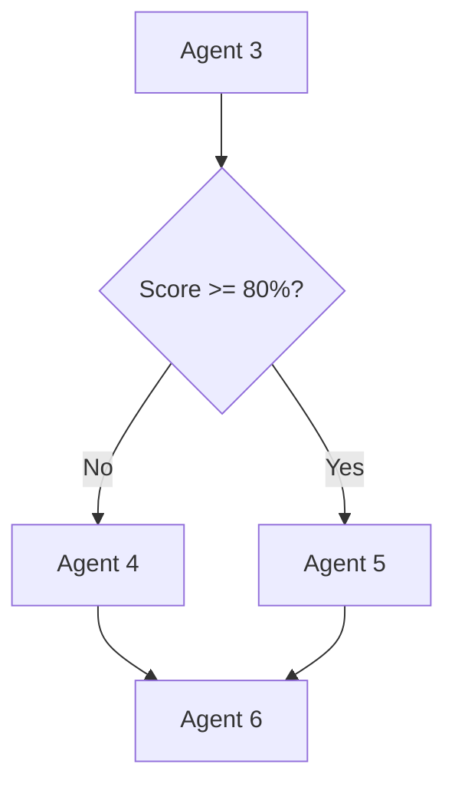
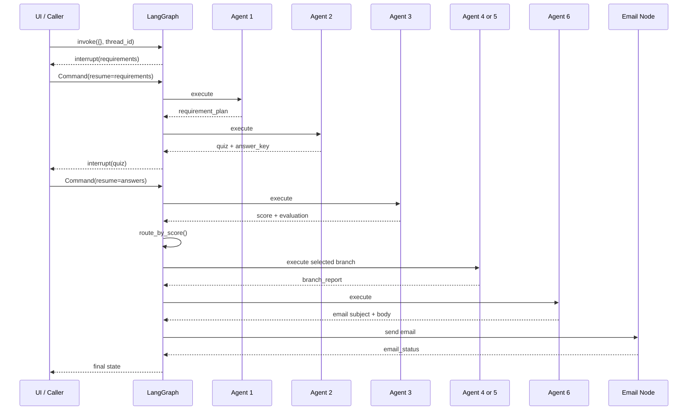

# Know Your Strength - LangGraph Multi-Agent Assessment

A multi-agent assessment workflow built with **Python, LangGraph, Ollama, Gemma 2, Pydantic, Streamlit, and SMTP**.

The main focus of this project is the **LangGraph orchestration layer**: how shared state is created, how agents are implemented as graph nodes, how nodes are connected with edges, how conditional routing is handled, and how the graph pauses and resumes for human input.

---

## 1. LangGraph Workflow



The graph contains three different kinds of nodes:

| Node Type | Nodes | Responsibility |
|---|---|---|
| Human interaction | `collect_requirements`, `collect_answers` | Pause the graph and wait for user input |
| AI agents | Agent 1 to Agent 6 | Perform reasoning using `gemma2:latest` |
| Tool/infrastructure | `send_email` | Perform the external email action |

The six AI agents do not call each other directly. LangGraph controls the execution order, while data moves between nodes through the shared graph state.

---

# 2. Project Structure

```text
project/
|
|-- pyproject.toml
|-- uv.lock
|-- .env
|-- README.md
|
|-- assessment_agents/
|   |-- __init__.py
|   |-- config.py
|   |-- schemas.py
|   |-- state.py
|   |-- llm.py
|   |-- routing.py
|   |-- graph.py
|   |-- main.py
|   |-- ui.py
|   |-- email_service.py
|   |
|   `-- agents/
|       |-- __init__.py
|       |-- input_nodes.py
|       |-- agent1_requirements.py
|       |-- agent2_quiz.py
|       |-- agent3_evaluator.py
|       |-- agent4_weakness.py
|       |-- agent5_strength.py
|       `-- agent6_report.py
|
`-- tests/
    `-- test_routing.py
```

The important LangGraph files are:

- `state.py` - defines the shared graph state.
- `schemas.py` - defines structured data exchanged with the LLM.
- `agents/` - contains human-input nodes and AI agent nodes.
- `routing.py` - contains the score-based routing decision.
- `graph.py` - registers nodes and connects all graph edges.
- `main.py` / `ui.py` - start and resume graph execution.

---

# 3. Step 1 - Define Structured Agent Contracts

File:

```text
assessment_agents/schemas.py
```

Before creating the graph, define the input and output structure expected from every agent.

The main Pydantic models are:

```text
RequirementInput
RequirementPlan
MCQ
Quiz
PerformanceAnalysis
ImprovementReport
EmailDraft
```

The purpose of these schemas is to make LLM output predictable.

Without a schema, an LLM may return arbitrary text. With a schema, each agent is expected to return data with a known structure that can safely be written into LangGraph state.

The contracts between the agents are therefore:

```text
User
 |
 v
RequirementInput
 |
 v
Agent 1
 |
 v
RequirementPlan
 |
 v
Agent 2
 |
 v
Quiz
 |
 v
Agent 3
 |
 v
PerformanceAnalysis
 |
 +----------------+
 |                |
 v                v
Agent 4          Agent 5
 |                |
 +--------+-------+
          |
          v
 ImprovementReport
          |
          v
        Agent 6
          |
          v
      EmailDraft
```

---

# 4. Step 2 - Define the Shared LangGraph State

File:

```text
assessment_agents/state.py
```

The graph uses one shared `AssessmentState`.

```python
class AssessmentState(TypedDict, total=False):
    raw_requirements: dict[str, Any]
    requirement_plan: dict[str, Any]

    quiz: list[dict[str, Any]]
    answer_key: dict[str, str]

    user_answers: dict[str, str]

    score_percent: float
    correct_count: int
    incorrect_count: int

    evaluation: dict[str, Any]
    performance_analysis: dict[str, Any]

    branch_report: dict[str, Any]

    email_subject: str
    email_body: str
    email_status: str
```

The state is the communication channel between nodes.

A node receives the current state:

```python
def some_node(state: AssessmentState):
```

and returns only the fields that it wants to add or update:

```python
return {
    "some_state_field": value
}
```

LangGraph merges that returned dictionary into the graph state.

This means Agent 2 does not need to directly call Agent 3. Agent 2 writes the quiz into state, and Agent 3 reads it later when LangGraph executes that node.

---

# 5. State Lifecycle

The state grows as the workflow moves through the graph.



| Graph Stage | State Written |
|---|---|
| Requirement input node | `raw_requirements` |
| Agent 1 | `requirement_plan` |
| Agent 2 | `quiz`, `answer_key` |
| Answer input node | `user_answers` |
| Agent 3 | `score_percent`, counts, `evaluation`, `performance_analysis` |
| Agent 4 or Agent 5 | `branch_report` |
| Agent 6 | `email_subject`, `email_body` |
| Email node | `email_status` |

This state-based design keeps the agents loosely coupled.

---

# 6. Step 3 - Create the Shared LLM Factory

File:

```text
assessment_agents/llm.py
```

All six agents use the same local Ollama model:

```text
gemma2:latest
```

The project creates one reusable factory function:

```python
def get_llm(temperature: float = 0.0) -> ChatOllama:
    return ChatOllama(
        model=OLLAMA_MODEL,
        base_url=OLLAMA_BASE_URL,
        temperature=temperature
    )
```

The agents are different logical roles even though they use the same model.

Their specialization comes from:

```text
Different Prompt
     +
Different State Input
     +
Different Output Schema
     +
Different Responsibility
```

So the architecture is:

```text
                gemma2:latest
                      |
      +---------------+---------------+
      |       |       |       |       |
    Agent1  Agent2  Agent3  Agent4  Agent5 ...
```

---

# 7. Step 4 - Create the Requirement Input Node

File:

```text
assessment_agents/agents/input_nodes.py
```

The first graph node is not an AI agent. It is a human-interaction node.

Its responsibility is to pause the graph until requirement information is available.

```python
def collect_requirements(state: AssessmentState):
    user_input = interrupt({
        "type": "requirements",
        "message": "Provide assessment requirements"
    })

    validated = RequirementInput.model_validate(user_input)

    return {
        "raw_requirements": validated.model_dump(mode="json")
    }
```

The runtime behavior is:

```text
START
  |
  v
collect_requirements
  |
  v
interrupt()
  |
  +------ graph pauses
             |
             v
         user input
             |
             v
      Command(resume=...)
             |
             v
     graph continues
```

The graph state is checkpointed while it is waiting for the user.

---

# 8. Step 5 - Create Agent 1: Requirement Analyst

File:

```text
assessment_agents/agents/agent1_requirements.py
```

Agent 1 reads:

```text
state["raw_requirements"]
```

and produces:

```text
state["requirement_plan"]
```

Its responsibility is limited to requirement analysis:

- Normalize the requested subject.
- Understand learner level.
- Understand requested difficulty.
- Consider the assessment goal.
- Consider requested focus areas.
- Define realistic coverage areas for ten questions.
- Define the assessment objective.

Agent 1 uses structured output:

```python
structured_llm = (
    get_llm(temperature=0.0)
    .with_structured_output(RequirementPlan)
)
```

The node finally returns:

```python
return {
    "requirement_plan": result.model_dump()
}
```

Agent 1 deliberately does not generate MCQs. That responsibility belongs to Agent 2.

---

# 9. Step 6 - Create Agent 2: Subject Expert / MCQ Generator

File:

```text
assessment_agents/agents/agent2_quiz.py
```

Agent 2 reads:

```text
raw_requirements
requirement_plan
```

and writes:

```text
quiz
answer_key
```

Agent 2's responsibilities are:

- Act as a subject expert.
- Generate exactly ten MCQs.
- Cover the areas selected by Agent 1.
- Respect level and difficulty.
- Generate four options for each question.
- Keep one correct option.
- Generate an explanation for the correct answer.

The quiz is generated with structured output:

```python
structured_llm = (
    get_llm(temperature=0.2)
    .with_structured_output(Quiz)
)
```

The node stores both the questions and the answer key:

```python
return {
    "quiz": questions,
    "answer_key": answer_key
}
```

The answer key remains internal to the graph and is not exposed to the learner before submission.

---

# 10. Step 7 - Create the Answer Input Node

File:

```text
assessment_agents/agents/input_nodes.py
```

After Agent 2 completes, the graph reaches another human-interaction node.

The node creates a public representation of the questions containing only:

```text
question id
question text
topic
A / B / C / D options
```

The internal fields are excluded:

```text
correct_option
explanation
```

The node then pauses:

```python
answers = interrupt({
    "type": "quiz",
    "questions": public_questions
})
```

After the answers are supplied, they are normalized and written to:

```text
state["user_answers"]
```

At this point the state contains everything Agent 3 needs to evaluate the assessment.

---

# 11. Step 8 - Create Agent 3: Evaluation Agent

File:

```text
assessment_agents/agents/agent3_evaluator.py
```

Agent 3 is intentionally divided into two responsibilities.

## Deterministic Python Responsibility

Python performs operations that must always be exact:

- Validate that every answer is A, B, C, or D.
- Compare user answers with the internal answer key.
- Count correct answers.
- Count incorrect answers.
- Calculate percentage score.
- Build question-level evaluation details.
- Build topic-level statistics.

The score calculation remains outside the LLM:

```python
score = round(
    (correct_count / total_questions) * 100,
    2
)
```

## AI Responsibility

After Python calculates the objective results, Gemma receives those results and performs interpretation.

Agent 3 identifies:

- Strengths.
- Weaknesses.
- Misconceptions.
- Patterns across incorrect answers.
- Important observations.

The node writes:

```text
score_percent
correct_count
incorrect_count
evaluation
performance_analysis
```

This separation is deliberate:

```text
Python                  Gemma 2
  |                        |
  | exact comparison       | interpretation
  | score calculation      | strengths
  | counts                 | weaknesses
  | statistics             | misconceptions
  |                        |
  +------------+-----------+
               |
               v
        Agent 3 Output
```

---

# 12. Step 9 - Create the Routing Function

File:

```text
assessment_agents/routing.py
```

The routing function is not an AI agent. It is deterministic Python logic.

```python
def route_by_score(state: AssessmentState):
    if state["score_percent"] >= PASS_THRESHOLD:
        return "agent5_strength"

    return "agent4_weakness"
```

The result returned by this function must match the node name registered in `graph.py`.

The routing rule is:

```text
score < 80%   -> agent4_weakness
score >= 80%  -> agent5_strength
```

This is the conditional part of the LangGraph workflow.

---

# 13. Step 10 - Create Agent 4: Weakness Analysis

File:

```text
assessment_agents/agents/agent4_weakness.py
```

Agent 4 executes only when the routing function selects the low-score branch.

It reads:

```text
score_percent
evaluation
performance_analysis
```

Its responsibility is remediation-focused analysis:

- Identify weak subject areas.
- Analyze incorrect answers.
- Identify misunderstood concepts.
- Reinforce the correct concepts.
- Create improvement actions.
- Create practice recommendations.

The node writes its result into:

```text
state["branch_report"]
```

---

# 14. Step 11 - Create Agent 5: Strength Analysis

File:

```text
assessment_agents/agents/agent5_strength.py
```

Agent 5 executes only when the routing function selects the high-score branch.

It reads the same evaluation information as Agent 4, but its responsibility is different:

- Identify demonstrated strengths.
- Highlight topics already understood well.
- Detect remaining knowledge gaps.
- Recommend advanced learning areas.
- Recommend practical next steps.

Agent 5 also writes to:

```text
state["branch_report"]
```

Using the same state field for both branches is useful because Agent 6 does not need to know which branch executed. It simply reads the final branch report.

---

# 15. Step 12 - Merge the Conditional Branches

Agent 4 and Agent 5 are mutually exclusive.

Only one executes during an assessment.

After either node completes, both routes converge into Agent 6:



This branch merge is created using two normal edges:

```python
builder.add_edge(
    "agent4_weakness",
    "agent6_report"
)

builder.add_edge(
    "agent5_strength",
    "agent6_report"
)
```

Because both branches write the same `branch_report` field, Agent 6 receives a consistent state structure.

---

# 16. Step 13 - Create Agent 6: Final Report Agent

File:

```text
assessment_agents/agents/agent6_report.py
```

Agent 6 is the final AI node.

It reads:

```text
raw_requirements
score_percent
correct_count
performance_analysis
branch_report
```

Its responsibility is to transform the assessment results into a final learner-facing report.

It generates:

```text
email_subject
email_body
```

The generated email contains the overall score, strengths, improvement areas, recommendations, and next steps.

Agent 6 does not perform email delivery. It only creates the content.

This keeps AI generation separate from external side effects.

---

# 17. Step 14 - Create the Email Tool Node

File:

```text
assessment_agents/email_service.py
```

The email node is infrastructure rather than an AI agent.

It reads:

```text
raw_requirements.email
email_subject
email_body
```

It sends the message through SMTP and writes:

```text
state["email_status"]
```

The separation is:

```text
Agent 6
  |
  | generates content
  v
email_subject + email_body
  |
  v
send_email node
  |
  | performs external action
  v
SMTP
```

This keeps SMTP credentials and email transport outside the LLM prompt.

---

# 18. Step 15 - Create the StateGraph

File:

```text
assessment_agents/graph.py
```

The graph starts with the shared state definition:

```python
builder = StateGraph(AssessmentState)
```

This creates the workflow builder but does not yet define any execution path.

---

# 19. Step 16 - Register Every Node

Each Python function becomes a LangGraph node through `add_node()`.

```python
builder.add_node(
    "collect_requirements",
    collect_requirements
)

builder.add_node(
    "agent1_requirements",
    agent1_analyze_requirements
)

builder.add_node(
    "agent2_generate_quiz",
    agent2_generate_quiz
)

builder.add_node(
    "collect_answers",
    collect_answers
)

builder.add_node(
    "agent3_evaluate",
    agent3_evaluate
)

builder.add_node(
    "agent4_weakness",
    agent4_weakness
)

builder.add_node(
    "agent5_strength",
    agent5_strength
)

builder.add_node(
    "agent6_report",
    agent6_generate_report
)

builder.add_node(
    "send_email",
    send_email_node
)
```

The first argument is the node name used by the graph.

The second argument is the Python function that LangGraph executes for that node.

Therefore:

```text
Node Name                Python Function
-------------------------------------------------
collect_requirements  -> collect_requirements()
agent1_requirements   -> agent1_analyze_requirements()
agent2_generate_quiz  -> agent2_generate_quiz()
collect_answers       -> collect_answers()
agent3_evaluate       -> agent3_evaluate()
agent4_weakness       -> agent4_weakness()
agent5_strength       -> agent5_strength()
agent6_report         -> agent6_generate_report()
send_email            -> send_email_node()
```

Registering a node does not determine when it runs. Execution order comes from edges.

---

# 20. Step 17 - Connect the Sequential Edges

The first part of the workflow is fully sequential:

```text
START
  -> collect_requirements
  -> agent1_requirements
  -> agent2_generate_quiz
  -> collect_answers
  -> agent3_evaluate
```

It is created with:

```python
builder.add_edge(
    START,
    "collect_requirements"
)

builder.add_edge(
    "collect_requirements",
    "agent1_requirements"
)

builder.add_edge(
    "agent1_requirements",
    "agent2_generate_quiz"
)

builder.add_edge(
    "agent2_generate_quiz",
    "collect_answers"
)

builder.add_edge(
    "collect_answers",
    "agent3_evaluate"
)
```

A normal edge means:

> After node A completes successfully, execute node B.

---

# 21. Step 18 - Connect the Conditional Edge

After Agent 3, the next node depends on `score_percent`.

Instead of `add_edge()`, this section uses:

```python
builder.add_conditional_edges(
    "agent3_evaluate",
    route_by_score
)
```

Execution becomes:

```text
agent3_evaluate
       |
       v
 route_by_score(state)
       |
       +---------------------------+
       |                           |
       v                           v
agent4_weakness             agent5_strength
```

The router examines the latest graph state and returns the name of the next node.

This is the key conditional-flow feature in this project.

---

# 22. Step 19 - Reconnect Both Branches

After either Agent 4 or Agent 5 finishes, the workflow must continue to Agent 6.

```python
builder.add_edge(
    "agent4_weakness",
    "agent6_report"
)

builder.add_edge(
    "agent5_strength",
    "agent6_report"
)
```

This converts two alternative branches back into one common workflow.

```text
Agent 4 -----\
              \
               -> Agent 6
              /
Agent 5 -----/
```

---

# 23. Step 20 - Connect the Final Nodes

After Agent 6 creates the final report, the email node runs and the graph finishes.

```python
builder.add_edge(
    "agent6_report",
    "send_email"
)

builder.add_edge(
    "send_email",
    END
)
```

The final section is:

```text
Agent 6
   |
   v
send_email
   |
   v
END
```

---

# 24. Complete Edge Map

The full graph can be summarized as:

```text
START
  |
  v
collect_requirements
  |
  v
agent1_requirements
  |
  v
agent2_generate_quiz
  |
  v
collect_answers
  |
  v
agent3_evaluate
  |
  v
route_by_score
  |
  +----------------------+----------------------+
  |                                             |
  v                                             v
agent4_weakness                           agent5_strength
  |                                             |
  +----------------------+----------------------+
                         |
                         v
                  agent6_report
                         |
                         v
                    send_email
                         |
                         v
                        END
```

There are three edge patterns in this graph:

| Edge Pattern | Project Usage |
|---|---|
| Sequential edge | Agent 1 -> Agent 2 |
| Conditional edge | Agent 3 -> Agent 4 or Agent 5 |
| Converging edges | Agent 4 / Agent 5 -> Agent 6 |

---

# 25. Step 21 - Add Checkpointing

The graph must pause for requirements and quiz answers.

Because of these human-in-the-loop interruptions, the graph needs a checkpointer.

For the POC:

```python
checkpointer = InMemorySaver()
```

The graph is then compiled:

```python
return builder.compile(
    checkpointer=checkpointer
)
```

Checkpointing allows LangGraph to preserve the workflow state when execution stops at an `interrupt()`.

Without a checkpointer, the graph could not reliably resume the same assessment workflow after waiting for the user.

---

# 26. Step 22 - Use a Thread ID Per Assessment

Each graph execution is associated with a `thread_id`.

```python
config = {
    "configurable": {
        "thread_id": str(uuid4())
    }
}
```

The same `thread_id` must be reused every time the same assessment is resumed.

Conceptually:

```text
Assessment Session
       |
       v
   thread_id
       |
       +--> checkpoint after requirement interrupt
       |
       +--> checkpoint after quiz interrupt
       |
       +--> final graph state
```

This prevents one assessment's state from being confused with another assessment.

---

# 27. Step 23 - Start the Graph

The graph begins with an empty input:

```python
result = graph.invoke(
    {},
    config
)
```

Execution starts at `START` and immediately reaches:

```text
collect_requirements
```

That node calls `interrupt()`, so graph execution pauses.

At this point no AI agent has executed yet.

---

# 28. Step 24 - Resume the Requirement Interrupt

After the user submits the requirement information, the graph resumes using:

```python
graph.invoke(
    Command(resume=requirements),
    config
)
```

Because the same `thread_id` is used, LangGraph loads the existing checkpoint and continues the workflow.

The next automatic sequence is:

```text
collect_requirements completes
        |
        v
Agent 1
        |
        v
Agent 2
        |
        v
collect_answers
```

The graph then pauses for the second time.

---

# 29. Step 25 - Resume the Quiz Interrupt

After all ten answers are collected:

```python
graph.invoke(
    Command(resume=answers),
    config
)
```

LangGraph resumes from the second checkpoint.

From this point, no additional user interaction is required.

The graph automatically executes:

```text
Agent 3
  |
  v
Score Routing
  |
  +--> Agent 4
  |       or
  +--> Agent 5
          |
          v
        Agent 6
          |
          v
      send_email
          |
          v
         END
```

---

# 30. LangGraph Runtime Lifecycle

The complete runtime lifecycle is:



This is the most important flow to understand for revision.

---

# 31. Why the Agents Do Not Call Each Other Directly

The application intentionally avoids this style:

```text
Agent 1 calls Agent 2
Agent 2 calls Agent 3
Agent 3 calls Agent 4
```

Instead:

```text
Agent 1
   |
   | writes state
   v
LangGraph
   |
   | chooses next node
   v
Agent 2
```

This separation gives LangGraph control over:

- Execution order.
- Conditional routing.
- Human interruptions.
- Checkpointing.
- Workflow recovery.
- State propagation.

Each agent remains focused on one responsibility.

---

# 32. Agent Input and Output Summary

| Node | Main Input From State | Main Output To State |
|---|---|---|
| `collect_requirements` | Human response | `raw_requirements` |
| Agent 1 | `raw_requirements` | `requirement_plan` |
| Agent 2 | `raw_requirements`, `requirement_plan` | `quiz`, `answer_key` |
| `collect_answers` | `quiz` + human response | `user_answers` |
| Agent 3 | `quiz`, `answer_key`, `user_answers` | score, evaluation, performance analysis |
| Agent 4 | score + evaluation | `branch_report` |
| Agent 5 | score + evaluation | `branch_report` |
| Agent 6 | analysis + `branch_report` | `email_subject`, `email_body` |
| Email node | recipient + email content | `email_status` |

This table is effectively the data contract of the LangGraph workflow.

---

# 33. Deterministic Logic vs AI Logic

The project deliberately does not use the LLM for everything.

## Deterministic Python Logic

```text
Answer matching
Score calculation
Question counts
Topic statistics
Score threshold routing
SMTP execution
```

## AI Logic

```text
Requirement interpretation
Question generation
Performance interpretation
Weakness analysis
Strength analysis
Feedback generation
Email drafting
```

This architecture makes the workflow more predictable and easier to test.

---

# 34. Streamlit UI

Streamlit is only the interaction layer for this POC. It collects requirements, displays the generated MCQs, resumes the LangGraph interrupts, and displays the final state.

The LangGraph workflow itself is independent of Streamlit and can later be called from FastAPI, Flutter, or another UI without rewriting the agent logic.

---

# 35. Testing the LangGraph Flow

The most important deterministic test is the router.

```python
def test_70_goes_to_agent4():
    state = {"score_percent": 70}
    assert route_by_score(state) == "agent4_weakness"


def test_80_goes_to_agent5():
    state = {"score_percent": 80}
    assert route_by_score(state) == "agent5_strength"
```

Other useful tests include:

```text
Agent 2 always produces 10 questions
All MCQ answers are A/B/C/D
Answer key contains all question IDs
Score calculation matches correct_count / total
User-facing quiz does not expose the answer key
Agent 4 branch is selected below threshold
Agent 5 branch is selected at or above threshold
Agent 6 receives a branch report from either path
```

---

# 36. Running the Project

Run the CLI flow:

```bash
uv run python -m assessment_agents.main
```

Run the UI:

```bash
uv run streamlit run assessment_agents/ui.py
```

Run tests:

```bash
uv run pytest
```

---

# 37. Key LangGraph Revision Points

Remember the project in this order:

```text
1. Define Pydantic schemas
2. Define AssessmentState
3. Create LLM factory
4. Implement node functions
5. Create StateGraph(AssessmentState)
6. Register functions using add_node()
7. Connect sequential nodes using add_edge()
8. Route Agent 3 using add_conditional_edges()
9. Merge Agent 4 and Agent 5 back into Agent 6
10. Connect final email node and END
11. Add a checkpointer
12. Compile the graph
13. Start with graph.invoke()
14. Pause through interrupt()
15. Resume through Command(resume=...)
16. Reuse the same thread_id for the assessment
```

The essential architecture is:

```text
State
  +
Nodes
  +
Edges
  +
Conditional Routing
  +
Interrupt / Resume
  +
Checkpointing
  =
LangGraph Workflow
```

---

# 38. Examples

## Example Requirement

```text
Subject: Java
Learner Level: Advanced
Difficulty: Hard
Goal: Senior Java developer interview preparation
Focus Areas: Collections, Concurrency, JVM, Streams
```

## Example Agent 1 Result

```text
Normalized Subject: Advanced Java

Coverage Areas:
- Collections
- Concurrency
- JVM
- Streams
- Generics

Assessment Objective:
Evaluate advanced Java knowledge for a senior developer interview.
```

## Example Agent 2 Internal MCQ

```text
Question 1
Topic: Java Concurrency

Question:
Which Java interface represents a task that returns a result?

A. Runnable
B. Callable
C. Executor
D. Thread

Correct Option: B
Explanation: Callable can return a result and may throw checked exceptions.
```

The learner receives only the question and options, not the correct option or explanation.

## Example Agent 3 Result

```text
Correct: 7
Incorrect: 3
Score: 70%
```

This causes:

```text
70% < 80%
    |
    v
Agent 4
```

## Example High-Score Route

```text
Score: 90%

90% >= 80%
     |
     v
Agent 5
```

## Example Final Flow

```text
User submits requirements
        |
        v
Agent 1 creates plan
        |
        v
Agent 2 creates 10 MCQs
        |
        v
User submits answers
        |
        v
Agent 3 evaluates
        |
        v
Score-based routing
        |
   +----+----+
   |         |
Agent 4    Agent 5
   |         |
   +----+----+
        |
        v
     Agent 6
        |
        v
   Email Service
        |
        v
       END
```

## Example Email Configuration

```env
OLLAMA_BASE_URL=http://localhost:11434
OLLAMA_MODEL=gemma2:latest

PASS_THRESHOLD=80

SEND_EMAIL=true
SMTP_HOST=smtp.gmail.com
SMTP_PORT=587
SMTP_USER=knowyourstrength254@gmail.com
SMTP_PASSWORD=<GOOGLE_APP_PASSWORD>
SMTP_FROM=knowyourstrength254@gmail.com
```

Do not commit `.env` to source control.
